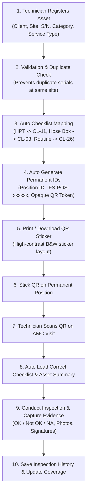

# Indus Fire Safety Private Limited — Digital AMC Inspection System

Standardised digital AMC inspection, testing, and compliance web application engineered for **Indus Fire Safety Private Limited (Vadodara, Gujarat)**.

---

## 1. End-to-End Business Workflow (Verified & Operational)



### Complete Sequence of Steps:
1. **Register New Asset:** Technician selects client & site, inputs equipment specifications (category, type, service type, serial number, capacity, manufacturing date, last HPT date, etc.).
2. **Duplicate Prevention:** Validates dates and strictly prevents duplicate serial numbers at the same client facility.
3. **Automatic Checklist Assignment:** Automatically assigns:
   - Fire Extinguisher Hydro Testing & Pressurisation $\rightarrow$ `CL-11` (`IFSPL/M&M/CL/011`, SOP `IFSPL/M&M/SOP/011`)
   - Delivery Hose Box Servicing $\rightarrow$ `CL-03` (`IFSPL/M&M/CL/003`, SOP `IFSPL/M&M/SOP/003`)
   - Routine Extinguisher Inspection $\rightarrow$ `CL-26` (`IFSPL/M&M/CL/026`)
   - Unmapped services trigger a clear audit warning and prevent silent assignment of unrelated checklists.
4. **Unique Permanent Identifiers:** Generates permanent Position ID (`IFS-POS-xxxxxx`) and stable, opaque QR token (`IFS-QR-IFS-POS-xxxxxx`).
5. **Printable QR Sticker Preview:** High-contrast, black-and-white sticker layout featuring company header, Position ID, QR code, equipment type, location, and serial number tag. Supports direct label printing (`window.print()`) and PNG download.
6. **QR Scan & Inspection Workflow:** Scanning or entering the Position ID instantly loads the compact asset summary and directly launches the assigned checklist without re-registration.
7. **Permanent Location vs Equipment Swaps:** Swapping a cylinder retains the position's permanent QR code unchanged, keeping removed and replacement units' lifecycle histories separate.

---

## 2. Quick Start & Setup Instructions

### Requirements
- Node.js (v18 or higher; tested on v24.18.0)
- Modern web browser (Chrome, Edge, Safari, Firefox)

### Start Development Server
The development server is running locally:
```bash
node node_modules/vite/bin/vite.js --host 0.0.0.0 --port 5173
```
Open **[http://localhost:5173](http://localhost:5173)** in your browser.

### Run Automated Acceptance Tests
```bash
node test.js
```
Runs both the Phase 1 Acceptance Suite (79 checks) and the Asset Registration & QR Workflow Suite (38 checks). **117 out of 117 tests pass.**

### Build Production Bundle
```bash
node node_modules/vite/bin/vite.js build
```

---

## 3. Screen Breakdown

1. **Login Screen:** Authenticated personas (Technician Ramesh Patel, Manager Sanjay Sharma, Client Officer Vikram Shah) with PIN verification.
2. **Site List & Operations Hub:** Industrial plants (*Aarti Industries, Atul Ltd, Deepak Nitrite, L&T Hazira*), dynamic site coverage calculated from actual records, and registered asset master directory.
3. **Register New Asset:** 4-step wizard (Client & Site $\rightarrow$ Equipment Details $\rightarrow$ Auto Checklist Assignment $\rightarrow$ Review & Submit) with duplicate serial detection.
4. **QR Scanner:** Live WebRTC camera stream (where permissions allow) with laser reticle, manual ID entry fallback, and unknown QR registration trigger.
5. **Asset Details & Cylinder Swaps:** Permanent position details, cylinder replacement workflow, editable location (with immutable QR preservation), and historical inspection log.
6. **Digital Checklist Form:** Dynamic forms for `CL-11`, `CL-03`, and `CL-26`, $\ge 48\text{px}$ touch buttons ($\sqrt{}$ OK, X Not OK, NA), mandatory defect reasons & photos for Not OK, and live counters matching rows 39–42 of workbook.
7. **Photo & Remarks Gallery:** Photographic evidence with click-to-zoom modal, photo removal, observations, and spares logger.
8. **Visit Summary & Signatures:** Equipment breakdown, calculated totals, dual HTML5 canvas touch signatures (Service Engineer & Client), and print dossier.
9. **Manager Dashboard:** Real-time coverage across contracted plants, upcoming IS 2190 hydro test pipeline (35 Bar / 3 mins), and attention flags.
10. **Client Safety Portal:** Dedicated read-only portal for client safety officers, verified equipment status, signature verification, and export dossier.
11. **Checklist Template Mappings:** Administrator modal to configure category and service type rules.
